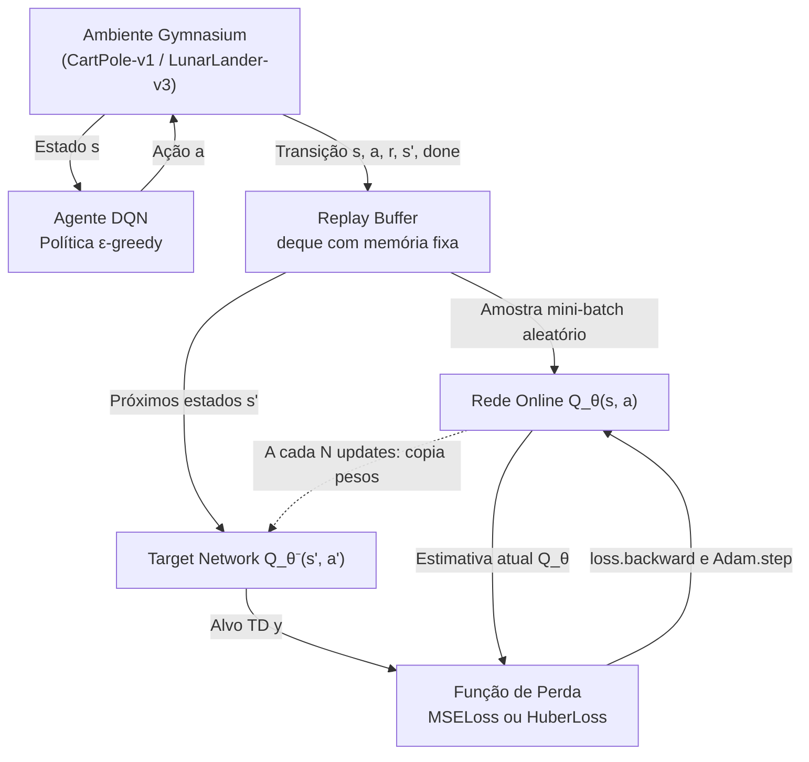
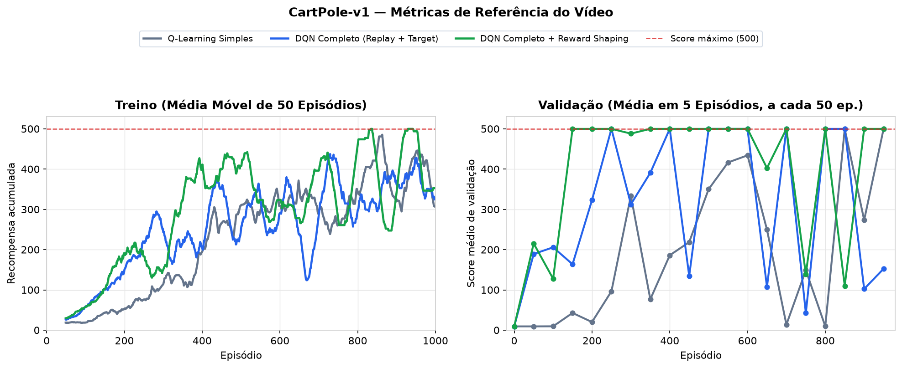
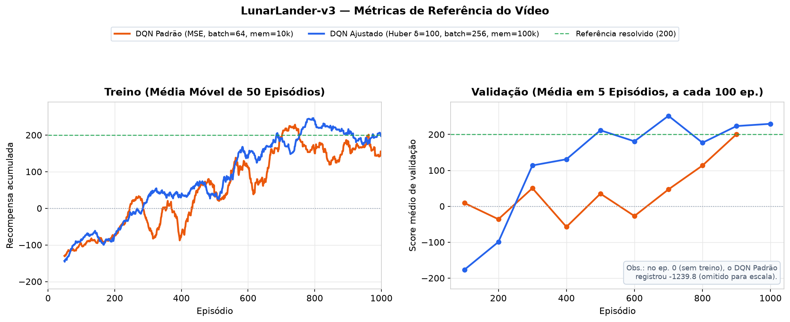

# 16 - Implementando Deep Q-Learning (DQN) do Zero em PyTorch

> **Construindo agentes de Aprendizado por Reforço do zero com PyTorch e Gymnasium: do Q-Learning básico com rede neural ao DQN com Experience Replay, Target Network, Reward Shaping e Huber Loss no CartPole-v1 e LunarLander-v3.**

[](https://youtu.be/z1ZTQd9p72U)

---

## 🎯 O Problema

No **Q-Learning tabular**, mantemos uma tabela mapeando cada par *(estado, ação)* ao seu retorno esperado $Q(s, a)$. Essa abordagem funciona muito bem em mundos discretos e pequenos, mas quebra imediatamente quando o estado é formado por variáveis contínuas:

- **CartPole-v1:** estado contínuo de 4 dimensões *(posição do carrinho, velocidade, ângulo da haste e velocidade angular)* e 2 ações discretas *(empurrar para esquerda ou direita)*.
- **LunarLander-v3:** estado contínuo de 8 dimensões *(coordenadas, velocidades linear/angular, ângulo da nave e contato das pernas com o solo)* e 4 ações discretas *(não fazer nada, motor esquerdo, motor principal, motor direito)*.

A solução do **Deep Q-Learning (DQN)** é substituir a tabela $Q$ por uma **rede neural** $Q_\theta(s, a)$ que recebe o vetor de estado contínuo $s$ e estima diretamente o valor esperado de retorno para cada ação possível.

---

## 💡 Como Funciona o Deep Q-Learning (DQN)

Neste projeto implementamos duas versões progressivas do agente em `q_learning.py`:

1. **`QLearningAgent` (Básico):** atualiza uma única rede neural a cada transição individual $(s, a, r, s', \text{done})$ usando `MSELoss` e exploração $\epsilon$-greedy.
2. **`QLearningAgentCompleto` (DQN):** adiciona os dois pilares clássicos que estabilizam o treinamento em redes neurais — **Experience Replay** e **Target Network** — além de permitir trocar a função de perda (como `HuberLoss` para ambientes com recompensas em escalas mais extremas).



### 1. Equação do Alvo TD (Temporal Difference)
A cada atualização, aproximamos o valor estimado pela rede online $Q_\theta(s, a)$ do alvo de Bellman calculado sem gradientes (`torch.no_grad()`):

$$y = r + \gamma \cdot \max_{a'} Q_{\theta^-}(s', a') \cdot (1 - \text{done})$$

Onde:
- $r$: recompensa imediata recebida do ambiente
- $\gamma$ (`0.99`): fator de desconto para recompensas futuras
- $\text{done}$: indicador de término do episódio (`terminated`), zerando a expectativa futura quando o agente falha/encerra
- $Q_{\theta^-}$: **Target Network**, uma cópia congelada dos pesos da rede online sincronizada periodicamente (`target_update_freq`) para evitar que o alvo se mova a cada passo

### 2. Política $\epsilon$-Greedy com Decaimento por Episódio
- Durante o treino (`agent.train()`), o agente escolhe uma ação aleatória com probabilidade $\epsilon$ (*exploração*) ou a ação de maior $Q$-value com probabilidade $1 - \epsilon$ (*explotação*).
- Ao final de cada episódio (`done=True`), $\epsilon$ decai exponencialmente ($\epsilon \leftarrow \max(\epsilon_{\min}, \epsilon \cdot 0.995)$), migrando gradualmente de exploração pura ($\epsilon = 1.0$) até um mínimo de $1\%$ ($\epsilon_{\min} = 0.01$).
- Durante a validação (`agent.eval()`), a exploração aleatória é desligada e o agente age de forma 100% gulosa.

### 3. Arquitetura da Rede Neural
Ambos os ambientes compartilham exatamente a mesma MLP simples definida em `build_model`:

$$\text{Input } (d_{\text{state}}) \longrightarrow \text{Linear}(64) \longrightarrow \text{ReLU} \longrightarrow \text{Linear}(64) \longrightarrow \text{ReLU} \longrightarrow \text{Linear}(n_{\text{actions}})$$

---

## 🔬 Experimentos e Métricas de Referência do Vídeo

Todos os experimentos abaixo foram executados por **1.000 episódios** em CPU com a mesma arquitetura de rede (`64 -> 64`) e $\gamma = 0.99$, $\eta = 0.001$ (Adam), $\epsilon_{\text{init}} = 1.0 \to \epsilon_{\min} = 0.01$ (`decay = 0.995`).

### Parte 1 — CartPole-v1

No `CartPole-v1`, o agente recebe `+1` a cada passo com a haste equilibrada, até o limite máximo de **500 passos**. Avaliamos três configurações progressivas (validação a cada 50 episódios, média em 5 episódios com seeds fixas):

1. **Q-Learning Simples (`QLearningAgent`):** sem replay buffer nem target network. Aprende a equilibrar, mas demora muito para convergir e oscila bastante.
2. **DQN Completo (`QLearningAgentCompleto`):** adiciona Experience Replay (`memory_size=10.000`, `batch_size=64`) e Target Network (`target_update_freq=100`). Atinge o score máximo de 500 na validação muito mais cedo (ep. 250 vs ep. 850).
3. **DQN Completo + Reward Shaping:** penaliza a distância do carrinho em relação ao centro passando `reward - abs(state[0])` ao `agent.learn(...)`, incentivando o agente a equilibrar a haste centralizada sem derivar para as bordas.



| Experimento (CartPole-v1) | Média Treino (1000 ep.) | Média Treino (Últimos 100 ep.) | Episódios c/ 500 (Treino) | Média Validação | 1ª Validação = 500 | Validações = 500 | Melhor Validação |
| :--- | :---: | :---: | :---: | :---: | :---: | :---: | :---: |
| **Q-Learning Simples** | `229.3` | `373.1` | `207 / 1000` (1º ep. 269) | `195.0` | Ep. `850` | `2 / 20` | `500.0` |
| **DQN Completo** *(Replay + Target)* | `253.5` | `376.1` | `311 / 1000` (1º ep. 241) | `306.7` | Ep. `250` | `8 / 20` | `500.0` |
| **DQN Completo + Reward Shaping** | **`294.8`** | **`423.3`** | **`432 / 1000`** (1º ep. 180) | **`399.6`** | **Ep. `150`** | **`13 / 20`** | **`500.0`** |

---

### Parte 2 — LunarLander-v3

No `LunarLander-v3`, o agente precisa pousar suavemente uma nave entre as bandeiras economizando combustível. Diferente do CartPole, a recompensa tem grande amplitude (quedas bruscas geram penalidades severas e pousos bem-sucedidos somam `+100` a `+300`; a referência clássica para considerar o ambiente resolvido é **$\ge 200$**).

Testamos o **mesmo código de agente** em duas configurações (validação a cada 100 episódios, média em 5 episódios):

1. **DQN Padrão (`--preset padrao`):** mesmos hiperparâmetros do CartPole (`MSELoss`, `batch_size=64`, `memory_size=10.000`, `target_update_freq=100`). A escala agressiva das recompensas amplifica o erro quadrático do MSE e deixa a validação instável.
2. **DQN Ajustado (`--preset ajustado`):** troca para `HuberLoss(delta=100.0)` (quadrática para erros menores que 100 e linear acima disso), aumenta o replay buffer para `100.000`, `batch_size=256` e `target_update_freq=250`. O resultado é uma convergência muito mais consistente acima da marca de `200` pontos.



| Experimento (LunarLander-v3) | Loss | Batch / Memória / Target Freq | Média Treino (1000 ep.) | Média Treino (Últimos 100 ep.) | Média Validação (ep. ≥ 300) | 1ª Validação ≥ 200 | Validações ≥ 200 | Melhor Validação | Última Validação |
| :--- | :---: | :---: | :---: | :---: | :---: | :---: | :---: | :---: | :---: |
| **DQN Padrão** | `MSELoss` | `64` / `10k` / `100` | `53.7` | `160.9` | `51.8` | Ep. `900` | `1 / 10` | `200.7` | `200.7` |
| **DQN Ajustado** | `HuberLoss(δ=100)` | `256` / `100k` / `250` | **`81.0`** | **`188.2`** | **`190.0`** | **Ep. `500`** | **`4 / 10`** | **`252.0`** | **`229.8`** |

> **Nota:** Os números acima são valores de referência da execução gravada no vídeo. Por envolver estocasticidade de amostragem, ambiente e versões de bibliotecas, novas execuções podem apresentar variações esperadas mantendo o mesmo comportamento qualitativo.

---

## 📂 Estrutura do Código

```
16_deep_q_learning/
├── images/
│   ├── cartpole_comparacao.png      # Gráfico de referência (treino e validação) no CartPole-v1
│   └── lunar_lander_comparacao.png  # Gráfico de referência (treino e validação) no LunarLander-v3
├── q_learning.py                    # Implementação de QLearningAgent e QLearningAgentCompleto (DQN)
├── teste.py                         # Script introdutório para testar a API do Gymnasium no CartPole-v1
├── cart_pole.py                     # Treino e avaliação no CartPole-v1 (suporta os 3 cenários do vídeo)
├── lunar_lander.py                  # Treino e avaliação no LunarLander-v3 (presets padrão e ajustado)
├── requirements.txt                 # Dependências do projeto
└── README.md                        # Documentação, teoria e métricas de referência
```

---

## ▶️ Como Executar

Execute os comandos a partir da pasta `16_deep_q_learning/`:

### 1. Preparação do Ambiente

> **Dica de compatibilidade (Box2D / LunarLander):** conforme mencionado no vídeo, o pacote `box2d` (usado no `LunarLander-v3`) possui melhor compatibilidade com **Python 3.12 ou 3.13**. Caso o `pip` precise compilar o Box2D localmente, instale o `swig` antes (`pip install swig`) e garanta que há um compilador C/C++ disponível no sistema. No vídeo o código foi executado em Linux via WSL, rodando inteiramente em CPU.

```bash
cd 16_deep_q_learning
python -m venv .venv
source .venv/bin/activate  # No Windows: .venv\Scripts\activate

# Se for rodar o LunarLander-v3 e o sistema precisar compilar o Box2D:
pip install swig

pip install -r requirements.txt
```

*(Se quiser testar **apenas o CartPole** sem instalar o Box2D, basta rodar: `pip install torch numpy "gymnasium[classic-control]"`.)*

### 2. Testar o Ambiente Básico

```bash
python teste.py
```

Abre a janela do `CartPole-v1` com um agente tomando ações aleatórias para validar a instalação do Gymnasium.

### 3. Treinar no CartPole-v1

```bash
# 1) Q-Learning simples (sem Replay Buffer e sem Target Network)
python cart_pole.py --agent simples --sem-reward-shaping

# 2) DQN completo com reward padrão do ambiente
python cart_pole.py --agent completo --sem-reward-shaping

# 3) DQN completo + Reward Shaping (configuração padrão do script)
python cart_pole.py
```

### 4. Treinar no LunarLander-v3

```bash
# 1) DQN com hiperparâmetros padrão (MSE, batch=64, memória=10k)
python lunar_lander.py --preset padrao

# 2) DQN ajustado com Huber Loss, batch=256 e memória=100k (configuração padrão do script)
python lunar_lander.py
```

*(Adicione `--no-render` em qualquer comando acima se estiver rodando em servidor/terminal sem interface gráfica, ou `--episodes N` para testar com menos episódios.)*

---

## 🧠 Conceitos Abordados

- **Aprendizado por Reforço e Gymnasium:** loop de interação agente-ambiente (`reset`, `step`, `observation`, `reward`, `terminated` vs `truncated`).
- **Deep Q-Learning (DQN):** aproximação da função $Q(s, a)$ por uma rede neural MLP em PyTorch para espaços de estados contínuos.
- **Temporal Difference (TD) Learning:** cálculo do alvo de Bellman com `torch.no_grad()` e máscara $(1 - \text{done})$.
- **Exploração vs Explotação ($\epsilon$-Greedy):** alternância entre treino (`agent.train()`) e avaliação (`agent.eval()`) com decaimento de $\epsilon$ por episódio.
- **Experience Replay:** quebra da correlação temporal das transições via buffer FIFO e amostragem aleatória de mini-batches (`q_values.gather(...)`).
- **Target Network:** estabilização do alvo de regressão copiando os pesos da rede online periodicamente.
- **Reward Shaping:** como modificar o sinal de recompensa (`reward - |state[0]|`) acelera a convergência e muda qualitativamente a política aprendida.
- **MSE vs Huber Loss:** por que a Huber Loss controla gradientes extremos em ambientes com recompensas de alta amplitude como o `LunarLander-v3`.

---

## 🛠️ Dependências

| Biblioteca | Versão Mínima | Uso |
| :--- | :---: | :--- |
| `torch` | `>=2.5` | Definição da rede $Q$, `Adam`, `MSELoss`, `HuberLoss` e autograd |
| `numpy` | `>=2.0` | Conversão eficiente de batches de estados e estatísticas de avaliação |
| `gymnasium[classic-control,box2d]` | `>=1.0` | Ambientes de simulação `CartPole-v1` e `LunarLander-v3` |
